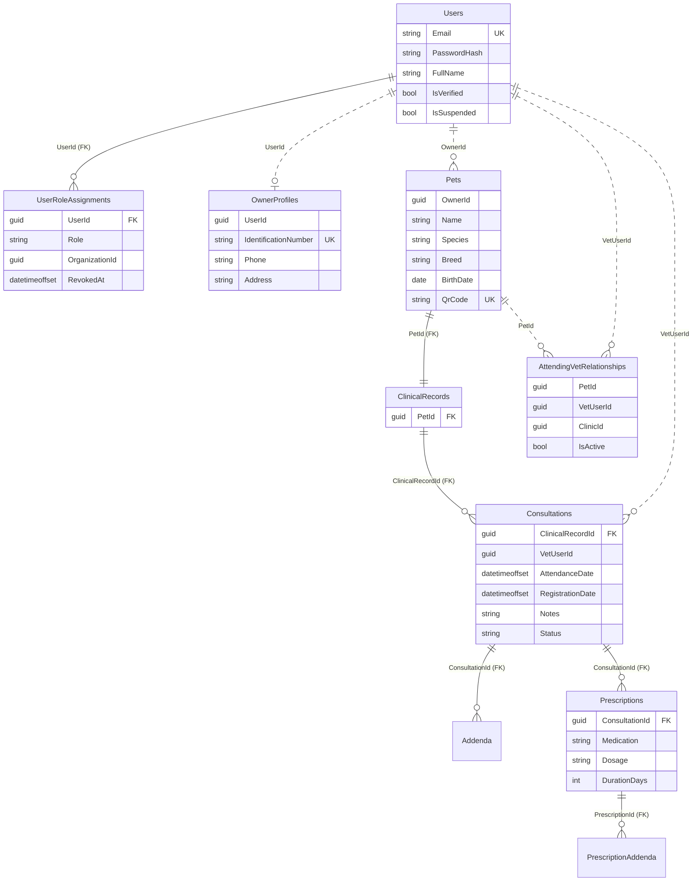
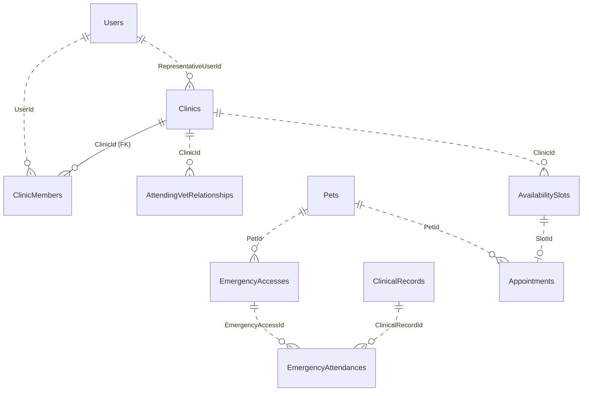
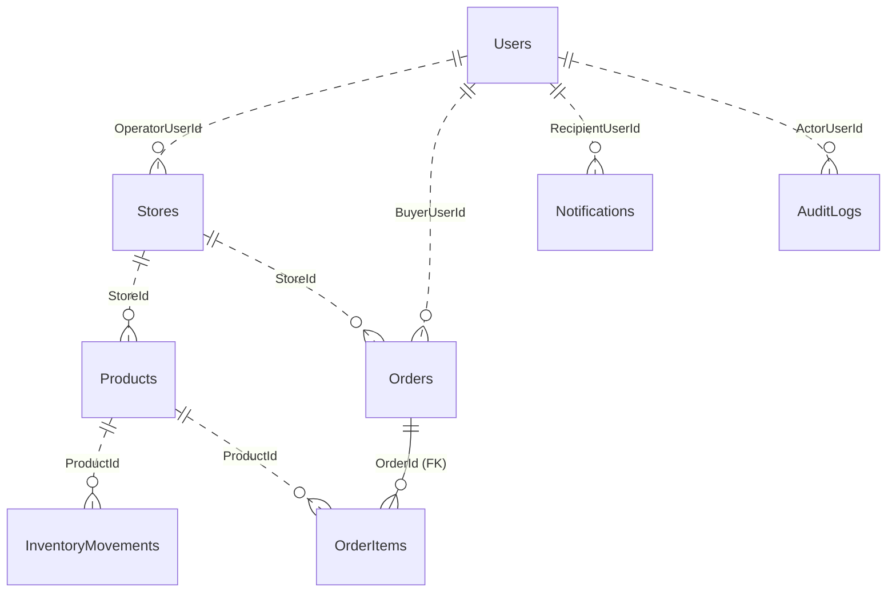

# Diagrama de la base de datos

Generado a partir de la migración real (`src/VetPlatform.Infrastructure/Data/Migrations/*_InitialCreate.cs`). GitHub y Visual Studio Code (con la extensión de Mermaid) lo muestran como imagen.

## Cómo leerlo
- **Línea continua (`||--o{`)**: **llave foránea real** en SQL Server. La base impide registros huérfanos. Hay 8.
- **Línea punteada (`||..o{`)**: **referencia lógica**, una columna `Guid` que apunta a otra tabla pero **sin restricción en la base**. La integridad la controlan los servicios de la aplicación.
- `||--o{` se lee "uno a muchos" (por ejemplo, un expediente tiene muchas consultas); `||--||` se lee "uno a uno".
- Todas las tablas tienen `Id` (uniqueidentifier) e `IsDeleted` (eliminación lógica); en el diagrama no se repiten.

## Núcleo clínico e identidad

## Clínicas, emergencias y agenda

## Marketplace y sistema

## Reglas que el diagrama no muestra
- **Un solo regente activo por mascota:** índice único filtrado `[IsActive] = 1` en `AttendingVetRelationships.PetId`.
- **Una sola cita activa por horario:** índice único filtrado `[Status] = 'Booked'` en `Appointments.SlotId`.
- **Cédula y perfil únicos entre los no eliminados:** índices filtrados `[IsDeleted] = 0` en `OwnerProfiles`.
- **Registros inmutables:** `Consultations`, `Prescriptions`, `Addenda`, `PrescriptionAddenda`, `EmergencyAttendances` y `AuditLogs` no admiten `UPDATE` desde la aplicación.
- **Concurrencia:** `Products.Version` y `AvailabilitySlots.Version` son tokens de concurrencia optimista.
